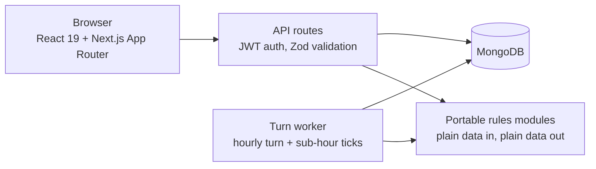

<div align="center">


# A House Divided

**A persistent multiplayer political and economic simulation that runs in your browser.**

Run for office, pass laws, found corporations and steer a national economy, in a shared world that advances every hour.

[](https://www.ahousedividedgame.com)
[](https://docs.lakesidegames.net)
[](https://discord.gg/DmF8zJJuqN)
<br>
[](https://github.com/lakesidegamedev/AHDGame/actions/workflows/ci.yml?query=branch%3Adevelopment)
[](https://github.com/lakesidegamedev/AHDGame/releases)
[](./LICENSE.md)

[Play](https://www.ahousedividedgame.com) · [Documentation](https://docs.lakesidegames.net) · [Changelog](https://www.ahousedividedgame.com/changelog) · [Contributing](./CONTRIBUTING.md) · [Security](./.github/SECURITY.md)

</div>

<table>
  <tr>
    <td width="50%"></td>
    <td width="50%"></td>
  </tr>
  <tr>
    <td align="center"><sub>Elections, from state results to the Electoral College</sub></td>
    <td align="center"><sub>Exchanges, bonds, commodities and supply contracts</sub></td>
  </tr>
</table>

<sub>Screenshots use demonstration data.</sub>

## About the game

Players create politicians and climb from local office to national leadership, or build business empires that the politicians have to reckon with. Every world starts from a real historical moment and plays forward from there. AI politicians and AI-run companies fill every seat and market that players leave open, so a world stays alive at any player count.

The main turn runs once per real hour. Stock markets tick every 15 minutes, and election returns, growth, inflation and exchange rates also move on the half hour.

| System        | What it covers                                                                                                                                                                                                                                                                                                                                     |
| ------------- | -------------------------------------------------------------------------------------------------------------------------------------------------------------------------------------------------------------------------------------------------------------------------------------------------------------------------------------------------- |
| **Eras**      | Worlds seed from a historical preset between 1953 and 2027: policies, budgets, demographics, seat maps, currencies, commodity prices, cabinets, franchise rules and court rosters. Era checkpoints shift the electorate as the calendar crosses real turning points.                                                                               |
| **Countries** | 25 registered countries on both sides of the Cold War, each resolved per world as playable or economy-only. Democracies and one-party states run their own political machinery.                                                                                                                                                                    |
| **Politics**  | First past the post, proportional (Sainte-Laguë and Hare), mixed-member, Electoral College and parliamentary selection. Primaries with delegate math, campaigns, full bill lifecycles with committees and whips, coalitions and confidence votes, cabinet confirmations, a working Supreme Court docket, impeachment, referendums and politburos.  |
| **Economy**   | Corporations build productive capacity, hire from a modeled labor market and compete for demand. Stock exchanges, index funds, corporate and sovereign bonds with defaults, central banks, per-country currencies, commodities with depletion, unions and strikes, budgets and sovereign debt, all reconciled by a double-entry ledger every turn. |
| **World**     | Cold War blocs, spheres of influence, crises and détente, international organizations, militaries and theaters.                                                                                                                                                                                                                                    |
| **Platform**  | In-game mail, news and wiki, a Discord bot and per-country event feeds, a public REST API with an MCP bridge, an admin console and an installable web app.                                                                                                                                                                                         |

## How it is built



| Layer      | Technology                                                                                                           |
| ---------- | -------------------------------------------------------------------------------------------------------------------- |
| Frontend   | Next.js 16, React 19, TypeScript, Tailwind CSS 4, next-intl                                                          |
| Backend    | Next.js route handlers (1,500+), Zod, MongoDB native driver                                                          |
| Simulation | An ordered pipeline of turn phases run by a dedicated turn worker, with a headless world simulator in `scripts/sim/` |
| Quality    | Vitest, Playwright, ESLint with custom rules, Semgrep, CodeQL, an architecture audit                                 |
| Operations | Sentry-compatible error monitoring, Cloudflare R2 for uploads                                                        |

Game rules (formulas, eligibility, resolution) live in `rules.ts` modules that take plain data and return plain data, so the same rules run in the hourly turn, in the headless simulator and in singleplayer. The architecture audit enforces this.

## Repository layout

| Path                                         | What lives there                                                                           |
| -------------------------------------------- | ------------------------------------------------------------------------------------------ |
| [`src/app`](./src/app)                       | Pages and API routes (Next.js App Router)                                                  |
| [`src/lib`](./src/lib)                       | Domain logic, one directory per game system                                                |
| [`src/simulation`](./src/simulation)         | Turn engine and turn phases                                                                |
| [`src/components`](./src/components)         | Shared React components                                                                    |
| [`src/shared`](./src/shared)                 | Formulas and constants used by both browser and server                                     |
| [`src/lib/seeds/wiki`](./src/lib/seeds/wiki) | Player wiki source                                                                         |
| [`scripts`](./scripts)                       | Seeders, world bootstrap, migrations, simulator, lint rules, CI and maintenance tooling    |
| [`tests`](./tests)                           | Playwright end-to-end tests and repository-wide checks (unit tests sit next to their code) |
| [`content/changelog`](./content/changelog)   | Changelog notes and release posts                                                          |
| [`messages`](./messages)                     | UI translations                                                                            |
| [`public`](./public)                         | Static assets, maps and images                                                             |
| [`docs`](./docs)                             | Design system reference                                                                    |
| [`vendor`](./vendor)                         | Vendored npm packages                                                                      |
| [`.github`](./.github)                       | CI workflows, Semgrep rules, issue templates, security policy, code of conduct             |

## Quick start

You need Node 20.19+ or 22.12+ and a MongoDB instance.

```bash
git clone https://github.com/lakesidegamedev/AHDGame.git
cd AHDGame
npm ci
cp .env.example .env.local   # set MONGODB_URI, AUTH_SECRET, ADMIN_REGISTRATION_KEY, CRON_SECRET
npm run bootstrap:full       # builds a complete historical world
npm run dev                  # http://localhost:3000
```

Register at `/register` with your `ADMIN_REGISTRATION_KEY` to get the admin console. The full local development guide, including environment variables, turn triggering, resets and the test commands, is in [CONTRIBUTING.md](./CONTRIBUTING.md#local-development).

## Contributing

Bug fixes, UI and accessibility polish, tests, documentation and country content are welcome. Balance changes, new mechanics and schema changes start with an issue. Read [CONTRIBUTING.md](./CONTRIBUTING.md) before opening a pull request; AI coding agents should also read [AGENTS.md](./AGENTS.md).

Found an exploit or vulnerability? Report it privately through [SECURITY.md](./.github/SECURITY.md), never in a public issue. Player account problems go through in-game support or [Discord](https://discord.gg/DmF8zJJuqN).

## Documentation

[docs.lakesidegames.net](https://docs.lakesidegames.net) hosts the player wiki, design notes and engineering guides. Their sources live in [lakesidegamedev/ahd-docs](https://github.com/lakesidegamedev/ahd-docs). The in-game wiki is seeded from [`src/lib/seeds/wiki`](./src/lib/seeds/wiki).

## License

[PolyForm Noncommercial 1.0.0](./LICENSE.md). Read it, run it locally, mod it and contribute. Commercial use, including running a commercial host, is not permitted. "A House Divided" and its logo are trademarks of Lakeside Games, and [ahousedividedgame.com](https://www.ahousedividedgame.com) is the official way to play.
